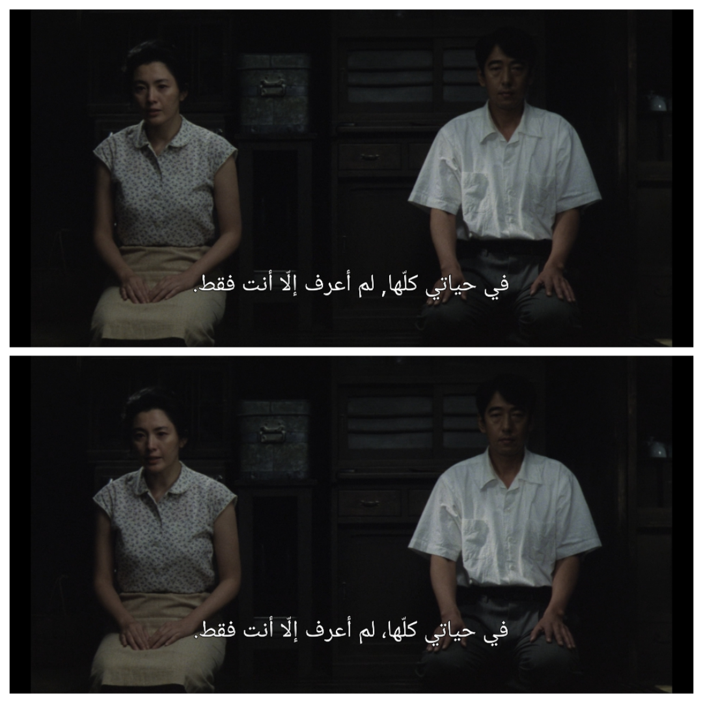
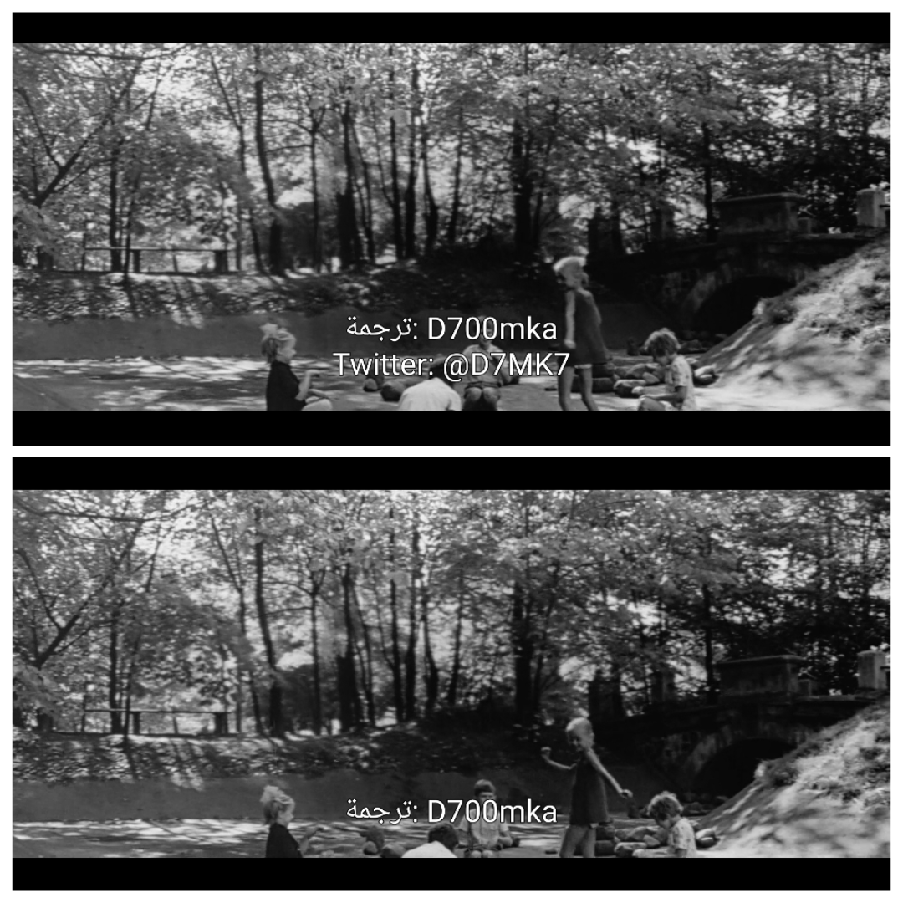
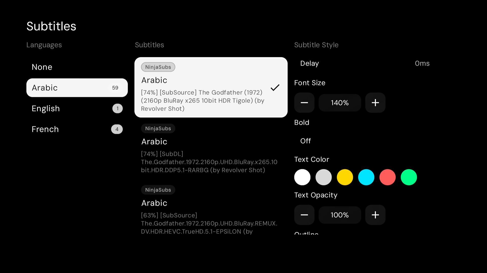

<div align="center">


**Smart, high-accuracy subtitle aggregator for Stremio featuring advanced Arabic subtitle optimization.**

[](https://www.python.org/)
[](https://fastapi.tiangolo.com/)
[](https://www.docker.com/)
[](LICENSE)

[English](#-english) · [العربية](#-العربية) · [Screenshots](#screenshots)

</div>

---

## English

A lightweight, self-hosted [Stremio](https://stremio.com) subtitle addon built with **Python 3.11+**, **FastAPI**, and **Uvicorn**. It aggregates subtitles from **three providers**, unpacks archives safely in memory, and streams native subtitles with a dedicated **Arabic Language Engine** for BiDi, punctuation, diacritics and numeral normalization.

### Highlights

- **Multi-provider aggregation** — SubDL, SubSource and OpenSubtitles with per-provider timeouts, resilient fallback, and provider-specific credential handling.
- **Arabic Subtitle Optimization** — context-aware RTL alignment, reversal repair, optional Tashkeel (diacritics) removal, Eastern-Arabic numerals and in-dialogue HI cleanup.
- **Auto-Sync Subtitles** — Automatic subtitle synchronization with Alass, verification, and safe fallback handling.
- **Stateless, per-user configuration** — every preference and API key is serialized into a URL-safe Base64 token embedded in the manifest URL; nothing is stored server-side.
- **Informative match badges** — compose the subtitle label from match score, provider, release filename and uploader.
- **Low footprint** — in-memory ZIP extraction (Zip Slip protected), LRU disk cache, and strict memory limits.

### Subtitle Providers

| Provider | Access |
| :--- | :--- |
| **SubDL** | API key |
| **SubSource** | API key |
| **OpenSubtitles** | API key |

### Features & Preferences

Every setting below is an independent, opt-in preference available in the [configuration UI](#configuration-ui). Choices are serialized into the stateless manifest token and included in the cache key, so toggling one never serves stale subtitles.

#### Arabic Subtitle Optimization
All Arabic processing is applied at **serve time** (per user) and is fully toggleable:

* **Arabic RTL Alignment Fix** — Automatically fix inverted punctuation, brackets, and quotes in Arabic subtitles to prevent misplaced periods.

<details id="screenshots">
<summary>🔍 <b>View Screenshot</b></summary>
<br>

</details>

* **Strip Arabic diacritics (Tashkeel)** — Removes Harakat while keeping Shadda, Tanween, and feminine Kasra.

<details>
<summary>🔍 <b>View Screenshot</b></summary>
<br>

</details>

* **Normalize Arabic commas** — Converts Latin commas in Arabic text to Arabic commas.

<details>
<summary>🔍 <b>View Screenshot</b></summary>
<br>

</details>

* **Convert numbers to Eastern Arabic** — Converts Western digits to Eastern Arabic numerals in Arabic dialogue.

<details>
<summary>🔍 <b>View Screenshot</b></summary>
<br>

</details>


#### Dialogue & Clean-up

- **Exclude HI (Hearing Impaired)**: Filters out tracks containing sound effects and audio descriptions. **(Hides entire HI subtitle tracks from the list)**
- **Strip In-dialogue HI Labels**: Cleans sound effects, audio cues, and speaker names while keeping dialogue intact (e.g. `[LAUGHS] JOHN: Hello there!` → `Hello there!`). **(Keeps the subtitle track, but removes the HI text inside it)**
- **Remove Ads**: Strips promotional links, websites, and social handles, then re-indexes SRT cues (e.g. Watch free at [www.example.com](https://www.example.com) — @promo_channel → (cue removed)).
- **Keep Translator Credits**: Preserves translator attribution lines while cleanly dropping attached spam and links.

<details>
<summary>🔍 <b>View Screenshot</b></summary>
<br>

* **Remove Ads:** [ON] — **Keep Translator Credits:** [ON]


</details>


#### Text Formatting & Timing

- **Clean Tags**: Balances and closes unclosed formatting tags (`<i>`/`<b>`) and removes unsupported wrappers (e.g. `<i>- Hello! <custom>world</custom>` → `<i>- Hello! world</i>`).
- **Strip Text Colors**: Removes HTML font color tags and ASS color codes (`{\c&H...&}`) to enforce the player's native styling (e.g. `<font color="#ff0000">Hello</font>` → `Hello`).

<details>
<summary>🔍 <b>View Screenshot</b></summary>
<br>

</details>

- **Normalize Spacing**: Collapses duplicate spaces and removes spaces before punctuation (e.g. `word  ,  next` → `word, next`).
- **Clean Symbols & Breaks**: Converts stray double hyphens into ellipses and removes stray `<br>` tags (e.g. `-- Wait <br>` → `... Wait`).
- **Fix Display Timing**: Clamps micro-overlaps (< 500ms) between consecutive cues to stop player flickering (e.g. `00:00:01,000 --> 00:00:03,000` & `00:00:02,800 --> 00:00:05,000` → clamped to `00:00:02,800`).
- **Convert ASS/SSA subtitles to SRT**: Enhances playback stability on Android TV (ExoPlayer) by converting ASS/SSA to SRT while retaining primary text colors and fixing Arabic RTL alignment.

### Auto-Sync Subtitles

Auto-Sync is an optional, best-effort timing correction system for subtitle tracks.

Enable Auto-Sync by setting `ENABLE_SUBTITLE_SYNC=true` in `.env`, restarting the service, and then enabling **Auto-Sync Subtitles** in the addon configuration. Docker images include `alass`, `ffmpeg`, and `ffprobe`; for local Python installations, these executables must be available on `PATH` or configured through `.env`.

When Auto-Sync is enabled, NinjaSubs tries to synchronize a subtitle to the **target video release** instead of blindly applying a fixed offset. Reference timing is selected conservatively from the strongest evidence available:

* **Exact OpenSubtitles MovieHash reference** — used only when the request includes a usable `moviehash` and `moviebytesize`. If no video hash is available, this exact-match path is skipped; NinjaSubs never guesses a hash match.
* **Compatible external release references** — SubDL, SubSource, and OpenSubtitles can provide release-matched candidates. Candidates are evaluated lazily, unsuitable or duplicate references are skipped, and later candidates remain available when an earlier one fails.
* **Embedded subtitle timing** — may be used when the client provides a usable stream URL and a compatible embedded track is available.

The synchronization pipeline then applies multiple strategies and safety checks:

* **Timeline Affine** can correct stable offset/drift patterns when the timing model is internally consistent.
* **ALASS** is used for harder alignment cases that need subtitle-to-subtitle timing analysis.
* Candidate results are checked before serving, and rejected or incomplete attempts normally fall back to the original subtitle.
* A dedicated **large-offset recovery path** has its own same-episode and anchor-consistency checks. It may serve an ALASS-corrected result when those checks pass even if the legacy verifier remains inconclusive; otherwise the original subtitle is preserved.
* Accepted synchronization results can be reused for the same target video through the sync cache, avoiding unnecessary re-alignment.

If no usable reference is available, alignment cannot be completed, safety checks reject the result, or the request reaches the sync time budget, Auto-Sync falls back to the original subtitle. A timed-out attempt may still finish in the background so that a usable cached result can become available for a later request.

Auto-Sync changes **timing only**. It does not translate subtitles or rewrite dialogue content. When **Convert ASS/SSA subtitles to SRT** is disabled, native ASS/SSA subtitles are preserved instead of being aligned through the SRT-based synchronization path.

#### Known limitation

Subtitles whose cue population or segmentation differs substantially from the reference can still be harder to verify even when their overall timing is close. The boundary-aware verifier is currently evaluated in **shadow mode only** and does not control production serving decisions, so conservative fallback to the original subtitle can still occur in these cases.

See [the autosync audit](docs/internal-reports/AUTOSYNC_AUDIT.md) for implementation details, verification work, and remaining limitations.

### Subtitle Badge Customizer

Customizes how subtitle tracks appear inside the Stremio or Nuvio player interface, allowing you to toggle and reorder metadata tags to match your preference:

* **Match Score (`[100%]`)** — Displays the filename matching accuracy score against the playing video stream.
* **Provider Tag (`[SubDL]`)** — Identifies the upstream subtitle provider source.
* **Release Name** — Displays the original video release tag (e.g. `WEB-DL-FLUX`).
* **Translator Credit (`(by 'username')`)** — Displays the subtitle author or translator.

<details>
<summary>🔍 <b>View Screenshot</b></summary>
<br>

</details>

### Arabic Subtitle Optimization

All Arabic processing is applied at **serve time** (per user) and is fully toggleable:

- **RTL punctuation & BiDi alignment** — appends a Right-to-Left Mark (RLM, `U+200F`) after trailing neutral punctuation so sentence-ending marks stay on the left; repairs legacy "reverse RTL" hacks and mirrored brackets/quotes, and fixes pre-reversed dialogue dashes.
- **Clean syntax & formatting** — independent toggles for tag repair, spacing, symbols (`-- → ...`), Latin→Arabic commas, unsafe/unclosed HTML `tags`, and display-timing overlap clamping (< 500 ms).
- **Strip Arabic diacritics (Tashkeel)** — removes Harakat while keeping Shadda, all Tanween types, and the feminine Kasra.
- **Convert to Eastern Arabic numerals** — (1, 2, 3) to (١، ٢، ٣), while protecting tags, timestamps and Latin/alphanumeric tokens (AK-47, MP4, Windows 11).
- **Strip in-dialogue HI labels** — removes `[MUSIC]`, `(SIGHS)`, `JOHN:` artifacts while keeping dialogue.
- **Encoding safety** — transcodes CP1256 / ISO-8859-6 to clean UTF-8.

### Quick Start (Docker)

```bash
cp .env.example .env
# set BASE_URL to your LAN address, e.g. http://192.168.1.50:7000

docker compose up -d --build
docker compose logs -f
```

Open `http://<HOST_IP>:7000/configure`, enter your keys, then **Install to Stremio** or **Copy Link**.

### Configuration UI

The web UI is a 3-step wizard and a stateless token:

1. **Providers** — pick sources and paste API keys.
2. **Preferences** — language engine, cleaning toggles, badge preview.
3. **Install** — addon host, Stremio install actions and the generated manifest URL.

#### A note on credentials in the install URL

The manifest token is **base64-encoded, not encrypted**. Anyone with the install
URL can recover its API keys.

NinjaSubs uses API-key-only OpenSubtitles search and download access. Legacy
account fields in saved tokens are ignored and omitted from new configurations.
No account login or JWT workflow is used.

### API Endpoints

| Endpoint | Method | Description |
| :--- | :--- | :--- |
| `/configure` | `GET` | Configuration wizard |
| `/{config}/configure` | `GET` | Prefilled configuration wizard |
| `/manifest.json` | `GET` | Default Stremio v3 manifest |
| `/{config}/manifest.json` | `GET` | User-configured manifest |
| `/subtitles/{type}/{id}.json` | `GET` | Subtitle search (server keys) |
| `/{config}/subtitles/{type}/{id}.json` | `GET` | Subtitle search (user keys) |
| `/sub/{sub_id}.srt` | `GET` | Serve UTF-8 subtitle |
| `/health` | `GET` | Health + cache statistics |

### Local Development

```bash
python -m venv .venv
.venv\Scripts\Activate.ps1        # Windows
# source .venv/bin/activate       # Linux/macOS

pip install -r requirements.txt
uvicorn app.main:app --host 0.0.0.0 --port 7000 --reload

pytest -q                          # tests
ruff check .                       # lint
mypy app                           # types
```

### License

This project is licensed under the **MIT License** — see [LICENSE](LICENSE).

> Note: the UI font "Serif Black" (`app/static/fonts/SerifBlackItalic.ttf`) is licensed by its source for personal use only.

---

## العربية

إضافة ترجمة خفيفة وذاتية الاستضافة لـ [Stremio](https://stremio.com)، مبنية بـ **Python 3.11+** و**FastAPI** و**Uvicorn**. تجمع الترجمة من **ثلاثة مصادر**، وتفكّ ضغط الملفات داخل الذاكرة بأمان، وتبثّ الترجمة مع **محرّك خاص باللغة العربية** لمعالجة الاتجاه (BiDi) وعلامات الترقيم والتشكيل والأرقام.

### أبرز المزايا

- **تجميع من عدة مصادر** — SubDL وSubSource وOpenSubtitles مع مهلة لكل مصدر، وآلية احتياطية عند الفشل، ومعالجة مستقلة لبيانات اعتماد كل مزود.
- **المزامنة التلقائية للترجمات** — مزامنة تلقائية للترجمات باستخدام Alass، مع التحقق من صحتها، ومعالجة آمنة للرجوع إلى الترجمة الأصلية (Fallback).
- **تحسين نصوص الترجمة العربية** — ضبط اتجاه النص من اليمين لليسار، وإصلاح النص المعكوس، وإزالة التشكيل (اختياري)، وتحويل الأرقام إلى الأرقام العربية المشرقية، وتنظيف وسوم الصوت الوصفية.
- **إعدادات لكل مستخدم بدون حفظ** — تُرمّز كل الإعدادات ومفاتيح الـ API داخل رابط الـ manifest (Base64) ولا يُخزَّن شيء على الخادم.
- **شارات مطابقة غنية** — تتكوّن من نسبة المطابقة والمصدر واسم الإصدار واسم الرافع.
- **استهلاك منخفض** — فكّ ضغط داخل الذاكرة (مع حماية Zip Slip) وذاكرة تخزين LRU مؤقتة.

### مصادر الترجمة

| المصدر | الوصول |
| :--- | :--- |
| **SubDL** | مفتاح API |
| **SubSource** | مفتاح API |
| **OpenSubtitles** | مفتاح API + حساب اختياري |

### المزايا والتفضيلات

كل إعداد أدناه تفضيل مستقل واختياري متاح في [واجهة الإعدادات](#واجهة-الإعدادات). تُرمّز الخيارات داخل رمز الـ manifest بدون حفظ على الخادم، وتُدرج في مفتاح الذاكرة المؤقتة، لذا لا يُقدَّم محتوى قديم عند تغيير أي إعداد.

#### تحسين نصوص الترجمة العربية
تُطبَّق جميع معالجات اللغة العربية لحظيًا عند طلب الترجمة (لكل مستخدم) مع إمكانية تفعيلها أو تعطيلها بالكامل:

- **ضبط الاتجاه والترقيم** — إصلاح تلقائي للترقيم والأقواس والاقتباسات المعكوسة في الترجمات العربية لمنع ظهور النقاط في غير موضعها.

<details>
<summary>🔍 <b>عرض لقطة الشاشة</b></summary>
<br>

</details>

- **إزالة التشكيل (Tashkeel)** — إزالة الحركات مع الحفاظ على الشدة وجميع أنواع التنوين والكسرة للمؤنث.

<details>
<summary>🔍 <b>عرض لقطة الشاشة</b></summary>
<br>

</details>

- **توحيد الفواصل العربية** — تحويل الفواصل اللاتينية إلى الفاصلة العربية في النص العربي.

<details>
<summary>🔍 <b>عرض لقطة الشاشة</b></summary>
<br>

</details>

- **تحويل الأرقام إلى الأرقام المشرقية** — تحويل الأرقام من (1, 2, 3) إلى (١، ٢، ٣) في الحوار العربي مع حماية الطوابع الزمنية والوسوم والرموز اللاتينية.

<details>
<summary>🔍 <b>عرض لقطة الشاشة</b></summary>
<br>

</details>

#### الحوار والتنظيف

- **استبعاد الصوت الوصفي (HI)**: استبعاد المسارات التي تحتوي على مؤثرات صوتية وأوصاف سمعية. **(يُخفي ترجمات HI كاملةً من القائمة)**
- **تنظيف وسوم HI داخل الحوار**: تنظيف المؤثرات الصوتية والإشارات الصوتية وأسماء المتحدثين مع الإبقاء على الحوار (مثال `[LAUGHS] JOHN: Hello there!` ← `Hello there!`). **(يبقي ملف الترجمة، لكن يحذف نص HI الموجود داخله)**.
- **إزالة الإعلانات**: إزالة الروابط والمواقع والمعرّفات الاجتماعية والنص الترويجي، ثم إعادة ترقيم مقاطع SRT (مثال Watch free at [www.example.com](https://www.example.com) — @promo_channel ← (cue removed)).
- **الإبقاء على حقوق المترجم**: الحفاظ على سطور نسب المترجم مع إزالة الروابط والسبام الملتصقة بها.

<details>
<summary>🔍 <b>عرض لقطة الشاشة</b></summary>
<br>

* **إزالة الإعلانات:** [ON] — **الإبقاء على حقوق المترجم:** [ON]


</details>

#### المزامنة التلقائية للترجمات

تُعد خاصية المزامنة التلقائية (Auto-Sync) نظامًا اختياريًا لتصحيح توقيت مسارات الترجمة بأفضل جهد ممكن (Best-effort).

لتفعيل المزامنة التلقائية، اضبط `ENABLE_SUBTITLE_SYNC=true` في ملف `.env`، ثم أعد تشغيل الخدمة وفعّل خيار **Auto-Sync Subtitles** من واجهة إعدادات الإضافة. تتضمن صور Docker أدوات `alass` و`ffmpeg` و`ffprobe`؛ أما عند التثبيت المحلي عبر Python فيجب أن تكون هذه الأدوات متاحة في `PATH` أو معرّفة عبر `.env`.

عند تفعيل الخاصية، يحاول NinjaSubs مزامنة الترجمة مع **إصدار الفيديو المستهدف** بدل تطبيق إزاحة زمنية ثابتة بشكل عشوائي. ويختار التوقيت المرجعي بصورة محافظة من أقوى الأدلة المتاحة:

* **مرجع OpenSubtitles المطابق عبر MovieHash** — لا يُستخدم إلا عند توفر `moviehash` و`moviebytesize` صالحين في الطلب. وإذا لم يتوفر Hash للفيديو، يُتخطى مسار المطابقة الدقيقة بالكامل ولا يتم افتراض تطابق Hash.
* **مراجع خارجية متوافقة مع الإصدار** — يمكن لـ SubDL وSubSource وOpenSubtitles تقديم مرشحين مرتبطين بنسخة الفيديو. تُفحص المرشحات تدريجيًا عند الحاجة، وتُتخطى المراجع غير المناسبة أو المكررة، مع الاستمرار إلى المرشح التالي إذا فشل السابق.
* **توقيت ترجمة مدمجة داخل الفيديو** — يمكن استخدامه عندما يوفّر العميل رابط بث صالحًا وتتوفر ترجمة مدمجة متوافقة.

بعد اختيار المرجع، يستخدم مسار المزامنة عدة استراتيجيات وطبقات أمان:

* يمكن لـ **Timeline Affine** تصحيح الإزاحة والانجراف الزمني المنتظم عندما يكون النموذج الزمني متسقًا.
* تُستخدم **ALASS** للحالات الأصعب التي تحتاج إلى محاذاة فعلية بين ملفي ترجمة.
* تُفحص النتائج قبل تقديمها، وعادةً ما تؤدي المحاولات المرفوضة أو غير المكتملة إلى الرجوع للترجمة الأصلية.
* يوجد مسار مخصص لمعالجة **الإزاحات الزمنية الكبيرة** يعتمد على فحوص مستقلة لاتساق الحلقة ونقاط الارتكاز. ويمكنه تقديم نتيجة مصححة بواسطة ALASS عندما تنجح هذه الفحوص حتى لو بقي المدقق القديم غير حاسم؛ وإلا تُحفظ الترجمة الأصلية.
* يمكن إعادة استخدام نتائج المزامنة المقبولة لنفس الفيديو عبر ذاكرة التخزين المؤقت للمزامنة (Sync cache)، لتجنب إعادة المعالجة دون حاجة.

إذا لم يتوفر مرجع صالح، أو تعذر إتمام المحاذاة، أو رفضت فحوص الأمان النتيجة، أو انتهت المهلة الزمنية للطلب (Sync time budget)، تعود الخاصية إلى الترجمة الأصلية. وقد تستمر محاولة انتهت مهلتها في الخلفية حتى تصبح نتيجة قابلة للاستخدام متاحة في الذاكرة المؤقتة لطلب لاحق.

تغيّر Auto-Sync **التوقيت فقط**؛ فهي لا تترجم النص ولا تعيد صياغة الحوار. وعند تعطيل خيار **Convert ASS/SSA subtitles to SRT** يتم الاحتفاظ بملفات ASS/SSA الأصلية بدل إدخالها في مسار المزامنة المعتمد على SRT.

##### قيد معروف

قد تكون الترجمات التي تختلف كثيرًا عن المرجع في عدد المقاطع أو طريقة تقسيم الحوار أصعب في التحقق حتى عندما يكون توقيتها العام قريبًا. يعمل المدقق المدرك للحدود (Boundary-aware verifier) حاليًا في **وضع الظل (Shadow Mode) فقط** ولا يتحكم في قرارات التقديم الفعلية، لذلك قد يستمر الرجوع المحافظ إلى الترجمة الأصلية في هذه الحالات.

للاطلاع على تفاصيل التنفيذ، وأعمال التحقق، والقيود المتبقية، راجع [تقرير تدقيق المزامنة التلقائية](docs/internal-reports/AUTOSYNC_AUDIT.md).

#### تنسيق النص والتوقيت

- **تنظيف الوسوم**: موازنة وإغلاق وسوم التنسيق غير المغلقة (`<i>`/`<b>`) وإزالة الأغلفة غير المدعومة (مثال `<i>- Hello! <custom>world</custom>` ← `<i>- Hello! world</i>`).
- **إزالة ألوان النص**: إزالة وسوم ألوان HTML وأكواد ألوان ASS (`{\c&H...&}`) لفرض التنسيق الأصلي للمشغل (مثال `<font color="#ff0000">Hello</font>` ← `Hello`).

<details>
<summary>🔍 <b>عرض لقطة الشاشة</b></summary>
<br>

</details>

- **توحيد المسافات**: دمج المسافات المكررة وإزالة المسافات الزائدة قبل علامات الترقيم (مثال `word  ,  next` ← `word, next`).
- **تنظيف الرموز والفواصل**: تحويل الشرطات المزدوجة إلى علامة حذف (`...`) وإزالة وسوم `<br>` الزائدة (مثال `-- Wait <br>` ← `... Wait`).
- **ضبط توقيت العرض**: قص التداخلات الدقيقة (< 500ms) بين المقاطع المتتالية لمنع وميض الترجمة (مثال `00:00:01,000 --> 00:00:03,000` و`00:00:02,800 --> 00:00:05,000` ← تُضبط إلى `00:00:02,800`).
- **تحويل ترجمات ASS/SSA إلى SRT**: يعزز استقرار التشغيل على Android TV (ExoPlayer) عبر تحويل ملفات ASS/SSA إلى صيغة SRT مع الاحتفاظ بألوان النص الأساسية وضبط محاذاة النص العربي (RTL).

### تخصيص شارات الترجمة (Subtitle Badge Customizer)
يتيح لك تخصيص مظهر مسارات الترجمة داخل مشغل Stremio أو Nuvio، مع إمكانية إظهار أو إخفاء وإعادة ترتيب الوسوم والمعلومات حسب رغبتك:

* **نسبة التطابق (`[100%]`)** — تعرض دقة تطابق ملف الترجمة مع ملف الفيديو المشغّل.
* **وسم المصدر (`[SubDL]`)** — يوضح الموقع أو المزود الذي تم جلب ملف الترجمة منه.
* **اسم النسخة (Release Name)** — يوضح وسم نسخة الفيديو الأصلية (مثل `WEB-DL-FLUX`).
* **اسم المترجم (`(by 'username')`)** — تعرض اسم المترجم أو رافع ملف الترجمة الأصلي.

<details>
<summary>🔍 <b>عرض لقطة الشاشة</b></summary>
<br>

</details>

### تحسين نصوص الترجمة العربية

تُطبَّق جميع معالجات اللغة العربية لحظيًا عند طلب الترجمة (لكل مستخدم) مع إمكانية تفعيلها أو تعطيلها بالكامل:

- **ضبط الاتجاه والترقيم** — إضافة علامة RLM (`U+200F`) بعد علامات الترقيم النهائية، وإصلاح حيل "RTL المعكوس" القديمة والأقواس/الاقتباسات المقلوبة، وضبط شَرطات الحوار المسبقة.
- **تنظيف الصياغة والتنسيق** — خيارات مستقلة لإصلاح الوسوم والمسافات والرموز (`-- ← ...`) والفواصل اللاتينية، ووسوم HTML غير الآمنة، وضبط تداخل التوقيت (< 500ms).
- **إزالة التشكيل (Tashkeel)** — إزالة الحركات مع الحفاظ على الشدة وجميع أنواع التنوين وكسرة المؤنث.
- **تحويل الأرقام إلى الأرقام العربية المشرقية** — تحويل الأرقام من (1, 2, 3) إلى (١، ٢، ٣)، مع حماية الوسوم والطوابع الزمنية والرموز اللاتينية (AK-47, MP4, Windows 11).
- **تنظيف وسوم الصوت الوصفية** — إزالة `[MUSIC]` و`(SIGHS)` و`JOHN:` مع الإبقاء على الحوار.

### التشغيل السريع (Docker)

```bash
cp .env.example .env
# اضبط BASE_URL على عنوان الشبكة المحلية، مثال: http://192.168.1.50:7000

docker compose up -d --build
docker compose logs -f
```

ثم افتح `http://<HOST_IP>:7000/configure`، أدخل المفاتيح، واضغط **Install to Stremio** أو **Copy Link**.

### واجهة الإعدادات

تتكوّن الواجهة من معالج من 3 خطوات ورمز بدون حفظ:

1. **المصادر** — اختيار المصادر ولصق مفاتيح الـ API.
2. **التفضيلات** — محرّك اللغة، خيارات التنظيف، ومعاينة الشارة.
3. **التثبيت** — عنوان الإضافة، وأزرار التثبيت في Stremio، ورابط الـ manifest المُنشأ.

### نقاط النهاية (API)

| نقطة النهاية | الطريقة | الوصف |
| :--- | :--- | :--- |
| `/configure` | `GET` | معالج الإعدادات |
| `/{config}/configure` | `GET` | معالج الإعدادات مع القيم المحفوظة |
| `/manifest.json` | `GET` | ملف manifest الافتراضي لـ Stremio v3 |
| `/{config}/manifest.json` | `GET` | ملف manifest المخصّص بالمفاتيح الشخصية |
| `/subtitles/{type}/{id}.json` | `GET` | البحث عن الترجمات (مفاتيح الخادم) |
| `/{config}/subtitles/{type}/{id}.json` | `GET` | البحث عن الترجمات (مفاتيح المستخدم) |
| `/sub/{sub_id}.srt` | `GET` | تقديم ملف ترجمة UTF-8 |
| `/health` | `GET` | حالة الخدمة وإحصاءات الذاكرة المؤقتة |

### التطوير المحلي

```bash
python -m venv .venv
.venv\Scripts\Activate.ps1        # Windows
# source .venv/bin/activate       # Linux/macOS

pip install -r requirements.txt
uvicorn app.main:app --host 0.0.0.0 --port 7000 --reload

pytest -q                          # tests
ruff check .                       # lint
mypy app                           # types
```

### الترخيص

هذا المشروع مُرخّص تحت **رخصة MIT** — انظر ملف [LICENSE](LICENSE).

> ملاحظة: خط الواجهة «Serif Black» (باستخدام `app/static/fonts/SerifBlackItalic.ttf`) مُرخّص من مصدره للاستخدام الشخصي فقط.

---

<div align="center">

**Made with ❤️ by donsaud · Free & Open Source for the community · v1.1.0**

[github.com/donsaud/NinjaSubs](https://github.com/donsaud/NinjaSubs)

</div>
